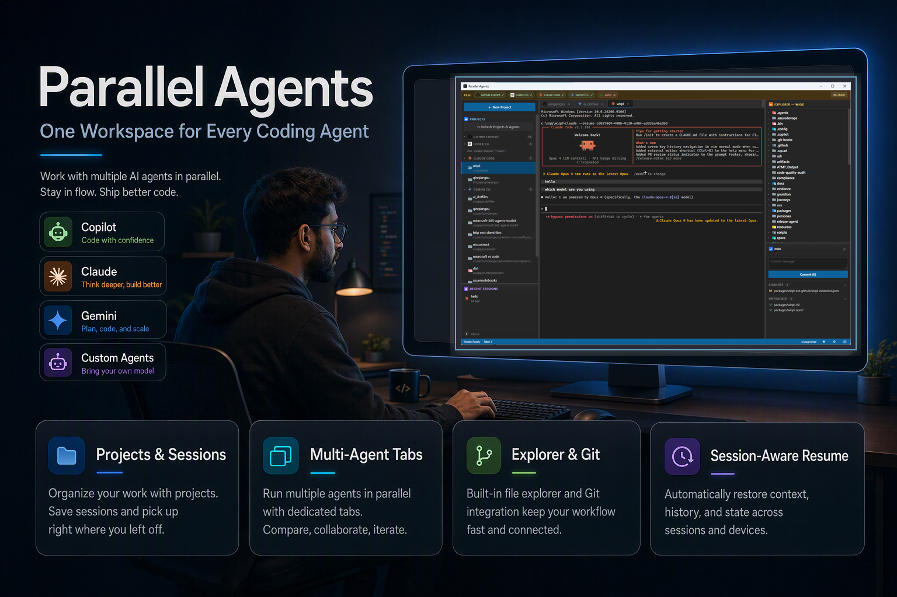
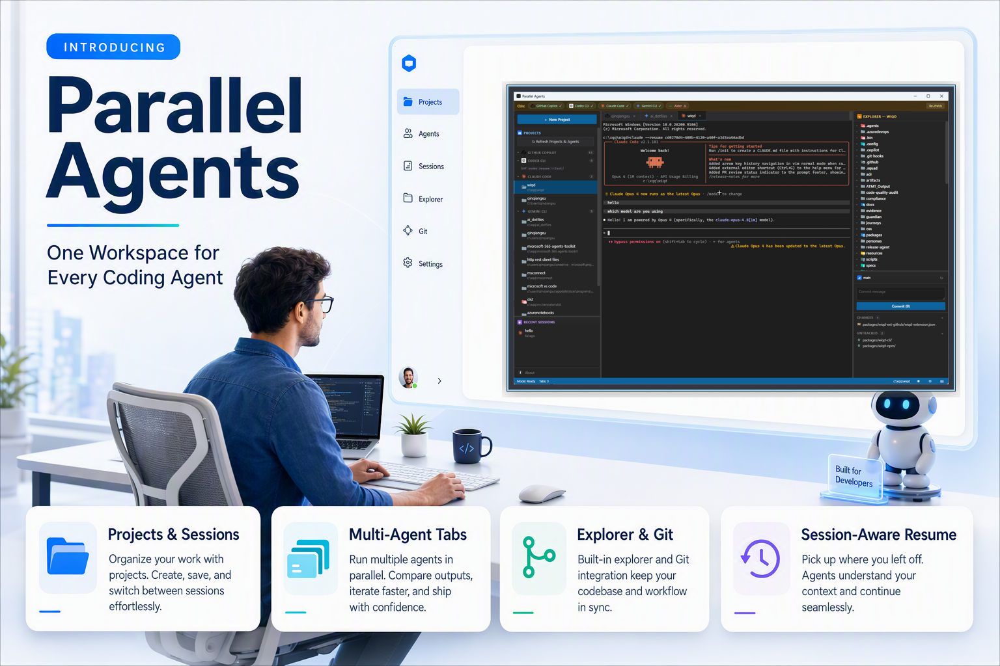

<div align="center">
  
  <h1>Parallel Agents</h1>
  <p><strong>CLI coding agents in one desktop window.</strong></p>
  <p>
    <a href="https://github.com/jelllove/Parallel-Agents/releases"></a>
    <a href="LICENSE"></a>
    
    
  </p>
</div>

Parallel Agents hosts locally installed coding CLIs in real terminals, with a project/session
sidebar, file explorer, and Git panel. It does not replace the agents or supply an AI service.
Launching an agent uses that CLI's own installation, authentication, and permissions.

[Quick start](#quick-start) · [Supported agents](#supported-agents) ·
[Architecture](ARCHITECTURE.md) · [Contributing](CONTRIBUTING.md) · [Agent guide](AGENTS.md)

## Features

- **Project and session discovery** for supported Claude Code, Codex, Copilot CLI, and Gemini CLI
  history formats, including Copilot repository/session metadata. Expand a project to see its
  sessions inline; there is no separate Recent Sessions panel. Git worktree sessions appear under
  their parent project with branch labels, while resuming in their own checkout.
- **Per-session tabs backed by real PTYs**, with agent start/resume commands, remembered agent
  choices, session rename/link flows, and optional attached shell panes.
- **Provider-specific launch settings** for approval modes and model IDs, saved independently
  per agent and applied to managed new/resumed launches without restarting running terminals.
- **New project workflow** for opening folders directly or creating Git worktrees before launch.
- **Recently opened folders in the same Create/Open dialog**, with folder icons, full paths and
  one-click reuse for both folder and worktree modes. Successfully opened folders persist across
  restarts, are deduplicated and sorted by latest use, and are not truncated to a fixed count.
- **Project cleanup** for deleting missing provider histories after review and acknowledgement.
- **File explorer** with create, rename, copy, move, trash, reveal, and default-application actions.
- **Git panel** for status, staging, unstaging, discarding, commits, and read-only Monaco diffs
  using locally bundled editor assets loaded on demand.
- **Configurable layout and typography**, including six column orders, saved pane sizes,
  dark/light themes, and persisted font size, family, and bold settings.
- **Focused coding view**: hide or restore the project sidebar and the files/Git sidebar
  independently, or hide both without restarting agent terminals.
- **Automatic updates** for installed Windows builds, with explicit restart confirmation.
- **Platform lifecycle**: Windows/macOS close hides the window; Linux close quits after session
  confirmation and does not require a tray. F11 toggles fullscreen.

### Project sidebar

Projects remain grouped by agent. Use the folder icon beside a project (an arrow on hover/focus)
to expand or collapse its sessions without launching a terminal. Sessions are ordered newest
first; multiple projects can stay expanded. Opening a project with multiple worktree entries
selects it and lets you choose the desired session. Empty checkouts offer **Start session**.

Project rows show just the name; hover for the full path. Sessions use indented, two-line rows
with muted branch/time metadata and a neutral selected background in both themes. Rename/delete
controls appear on hover or keyboard focus and retain their own space, so long names truncate
with an ellipsis rather than overlap the buttons. Widening the sidebar reveals more of each name.
Agent headings are separate background blocks with consistently sized icons rather than another
indented tree level. Project and two-line session rows use compact spacing.

Drag an Agent heading up or down to reorder the sections; the insertion line marks whether it
will land before or after the target heading. You can also focus a heading and use **Alt+Up/Down**.
Clicking a heading still expands or collapses it. Pinned and unpinned headings are
reordered separately; dragging or keyboard moves never change pin status.

Agent order, Agent/project expansion and the **show hidden** switch are saved with the existing layout
preferences and restored on the next launch, without automatically opening terminals. Inventory
refresh preserves manual collapse. Layout read/write failures appear in the sidebar with a
**Retry** action; controls wait for the saved tree state to load before accepting changes.

Existing Git worktrees, including worktrees created from another worktree, are grouped using
Git metadata rather than directory naming. If only a worktree is known, its parent repository
still supplies the group name. Unavailable directories without usable Git metadata remain
standalone so their histories can still be reviewed and cleaned.

Session rename/delete actions target the original history, not the parent project. Right-click a
worktree session (or its empty-checkout row) for that checkout's project actions. Cleanup mode
shows individual project histories so deletion selection stays explicit. Hidden histories stay
hidden unless **show hidden** is enabled; dragging a project moves its worktree group together.
Pinning a project-tree row pins its visible checkout histories together. A group with any pinned
checkout appears in the pinned partition; a checkout's context menu still targets that history.

## Quick start

### Quick-create, pin, and arrange projects

The top **New Project** button still opens the agent picker. Each agent heading also has a **+**
button that opens the same Create/Open dialog directly for that agent, including recent folders
and its launch settings. The shortcut is disabled when that CLI is not installed.

Use the pin button on an agent heading or a project row to **Pin / Unpin** it. Pinned agents stay
above other agents; pinned projects stay at the top of their own agent group. Drag an agent heading
to arrange groups, or drag a project to arrange it within the same agent. Pinned and unpinned items
are reordered separately: dragging does not change Pin status or move projects between agents.
Right-click a heading or project for **Move up / Move down** as an alternative to dragging.

Agent order, project order, and both kinds of pins are saved across restarts. These actions do not
open projects or restart terminals. Configuration failures are shown in the sidebar with a reload
action; an unsuccessful save is not shown as a persisted change.

### Hide sidebars and focus on coding

The bottom status bar always keeps three controls available:

- **Projects** hides/shows the project and session sidebar.
- **Files / Git** hides/shows the Explorer and Git column.
- **Focus coding** hides both sidebars so the terminal area fills the workspace; **Restore panels**
  shows both again.

Visibility is saved across restarts and works with every column order. Hidden panes remain
mounted, so toggling them does not restart agents, recreate terminals, or close session tabs.
The last fully expanded pane widths are preserved for restore; resizing with a sidebar hidden
does not overwrite those saved widths. Save failures are shown in the status bar and revert the
visibility change rather than claiming it persisted.

### Agent approval modes and models

Use **Options** beside an agent in the picker, **Configure ... approval mode and model** inside
New Project, or **Settings → Agent approval modes and models...**. Choose the provider first:
settings are stored independently and never reuse another provider's model ID.

| Agent          | Supported launch modes                                                                                                           | Model input                                                        |
| -------------- | -------------------------------------------------------------------------------------------------------------------------------- | ------------------------------------------------------------------ |
| GitHub Copilot | CLI default; auto-approve tools (`--allow-all-tools`), without adding all-path/all-URL permission flags                          | Exact model ID from Copilot's `/model` picker                      |
| Claude Code    | CLI default; normal prompts; plan; auto-accept edits; auto mode using Claude's safety classifier                                 | `sonnet`, `opus`, `haiku`, or a full supported Claude model ID     |
| Codex          | CLI default; untrusted-command approval with workspace-write sandbox; read-only sandbox; no prompts with workspace-write sandbox | Codex-supported ID from `/model`                                   |
| Gemini CLI     | CLI default; normal prompts; plan; auto-edit; YOLO approval mode                                                                 | Gemini model ID/alias from `/model`                                |
| Aider          | CLI default; always answer yes (`--yes-always`)                                                                                  | Aider/provider-qualified ID, discoverable with `/models <keyword>` |

Leave the model empty and select **Use CLI defaults** to preserve the previous command exactly.
CLI defaults can inherit previously granted permissions, environment/config settings, and managed
organization policies; it does not force every operation to ask. Copilot/Aider do not expose a
portable "force all manual approvals" override here. The app does not read credentials, contact
provider APIs, or present a supposedly universal/account-verified model list.

Saving a reduced-approval mode requires an explicit acknowledgement. Every actual launch in
that mode also shows a native confirmation with the agent, working folder and generated command;
Cancel is the default. Declining starts no terminal. Closing a tab while confirmation is pending
cannot start a late orphan process. Modes are not equivalent: Codex auto retains its workspace
sandbox; Copilot tool approval is not an all-path/all-URL grant; Aider yes mode creates no sandbox;
Claude auto uses the CLI classifier, not a permission bypass.

Saved choices apply to subsequent managed starts, resumes and restarts, including existing projects.
They do not modify running terminals, attached plain shells, or custom commands entered manually.
Model IDs are passed as one shell-safe token (up to 200 characters); unsupported/missing modes or
models are surfaced by the CLI, not silently replaced. Some modes require recent CLI versions,
model support or account entitlements; check each CLI's help if startup is rejected.

### Reuse an opened folder

Choose **New Project**, select an agent, then select a path under **Recently opened folders**.
This fills the existing folder field without launching anything until you confirm.
The same list is available when choosing a base repository for a Git worktree; selecting a
different base updates generated worktree paths but does not overwrite a manually entered target.
The scrollable list shows each folder's icon, name, and full path without a separate search box.

**Workspace mode** uses folder/branch icons to distinguish opening a local folder from creating
a Git worktree. The app remembers the last selected mode globally across agents and restarts,
even if you cancel the dialog without creating a project. Existing preferences default to opening
a folder. A loading/saving failure is shown with retry; a failed save retains the previous selection.
The approval/model configuration button is marked with a settings icon.

History is local to the application preferences and shared across agents. Existing registered
project paths seed the list when upgrading; older provider-only folders appear after you open
them again. Successful folder/worktree creation records the workspace and its worktree base;
successful terminal opens also record the workspace. Browsing then cancelling does not add history.
Missing/moved folders remain visible; attempting to open one reports an error rather than deleting
it or silently opening another folder. A malformed/unwritable preferences file is reported without
resetting user data. Removing a registered project does not erase its folder history.

### Use a release

Download the asset for your platform from
[jelllove releases](https://github.com/jelllove/Parallel-Agents/releases) or the
[qinqingxu mirror](https://github.com/qinqingxu/Parallel-Agents/releases).
Mirror availability depends on the release; compare the tag and asset list rather than
assuming both repositories' latest versions are identical.
Windows users can run the NSIS installer or extract the entire ZIP before running
`Parallel Agents.exe`. ZIP is an unpack-and-run distribution; preferences and provider histories
still use your home directory, not a portable profile stored alongside the executable.
Available artifacts depend on the release.
Versions before 0.1.10 do not include automatic updates, so install an updater-enabled build
manually once before relying on in-app checks.

### About and updates

The sidebar keeps its original compact **About** entry. Open it to view update status,
download progress, the installed version, source commit, author
website ([www.jelllove.com](http://www.jelllove.com)), and **Check for updates**.
Supported packaged Windows builds check automatically and download in the background;
**Restart to update** still asks for confirmation before stopping agents. Simply opening
About does not start an update check or install.

macOS, Linux, and development builds use manual updates. **View latest release / manual
download** opens the primary repository's latest release in your system browser so you can
choose the correct operating-system and architecture package. Link-opening and update-status
failures are shown in the dialog; a failed initial status read can be retried.

### macOS and Linux targets

Starting with v0.1.16, the release build targets the following platforms. Each release must pass
native and packaged-app smoke checks on its target host before its packages are published.
macOS/Linux are initial desktop ports, not a claim of compatibility with every system.

| Platform       | Architecture          | Main package                                | Additional formats                      |
| -------------- | --------------------- | ------------------------------------------- | --------------------------------------- |
| Windows        | x64                   | `Parallel-Agents-Setup-<version>.exe`       | `Parallel-Agents-<version>-win-x64.zip` |
| macOS          | Apple Silicon / ARM64 | `Parallel-Agents-<version>-mac-arm64.dmg`   | `.zip` with the same basename           |
| macOS          | Intel / x64           | `Parallel-Agents-<version>-mac-x64.dmg`     | `.zip` with the same basename           |
| Linux / Ubuntu | x64, glibc            | `Parallel-Agents-<version>-linux-amd64.deb` | AppImage, tar.gz, RPM (filenames below) |

Windows ZIP, Intel macOS, Linux tar.gz, and RPM are additions in v0.1.17.
Already-published v0.1.16 has the Windows installer, ARM64 Mac DMG/ZIP, and Linux DEB/AppImage;
it does not gain new assets merely because the source configuration changes.

On macOS, open the downloaded DMG and drag the application to
Applications, or extract the ZIP. Initial Mac builds are ad-hoc signed, **not Developer ID signed
or notarized**, and use no hardened-runtime release profile. Gatekeeper may block downloaded
builds; use Apple's per-application approval only for a build you trust, not a global security
bypass. Select the native ARM64 or Intel x64 asset for your Mac; these are separate packages,
not a universal binary. Each Mac architecture must pass its own native build/smoke gate
before its release assets are published.

Linux packages target x64 glibc desktops with X11 or XWayland:

- **Debian/Ubuntu:** `Parallel-Agents-<version>-linux-amd64.deb`; install the local file with
  `apt install` so dependencies are resolved.
- **Fedora/RHEL-style packaging:** `Parallel-Agents-<version>-linux-x86_64.rpm`; install the
  local file with `dnf install`. RPM generation does not establish compatibility with every
  Fedora/RHEL release; verify its dependencies and native behavior on the intended distribution.
- **Portable:** `Parallel-Agents-<version>-linux-x86_64.AppImage`; mark it executable and run it.
- **Archive:** `Parallel-Agents-<version>-linux-x64.tar.gz`; extract the whole directory and run
  its `parallel-agents` executable. Keep the bundled resources, native libraries, and sandbox helper
  together. This archive does not install a desktop entry or system dependencies.

Use the asset list of the release you download as the authority.
AppImage may require FUSE; distribution packages are preferable on systems that restrict
unprivileged user namespaces.
Do not run the app as root or pass `--no-sandbox` to work around a launch failure.
Linux ARM and musl-based distributions are outside this initial target.

#### Verified Linux distribution boundary

| Distribution                                     | Actual evidence                                                                                                                                                                                                     | Not established                                                                                                       |
| ------------------------------------------------ | ------------------------------------------------------------------------------------------------------------------------------------------------------------------------------------------------------------------- | --------------------------------------------------------------------------------------------------------------------- |
| Ubuntu 24.04.5 x64 (GitHub `ubuntu-24.04` image) | [Native CI at commit `86a5292`](https://github.com/jelllove/Parallel-Agents/actions/runs/37736832858): real Electron/PTY and app.asar smoke passed under Xvfb; DEB, AppImage, and RPM generation/hash checks passed | Interactive desktop installation, tar.gz runtime, or every Ubuntu version                                             |
| Debian, Fedora, RHEL and derivatives             | Package formats are available/configured                                                                                                                                                                            | Distribution-specific dependency resolution, installation, SELinux behavior and native runtime have not been verified |

Linux CI is pinned to `ubuntu-24.04` so its qualification target does not change when
`ubuntu-latest` moves. Generating RPM on Ubuntu is not a Fedora/RHEL compatibility certification.
Archive users must still satisfy Electron's system-library and sandbox requirements.

Mac/Linux updates are manual; installed Windows automatic updates remain unchanged.
For the Windows ZIP, replace the extracted folder for archive updates; choosing the Windows
in-app installer update installs the NSIS distribution rather than replacing that folder.
Git and the desired
agent CLIs must be installed separately. Desktop startup loads PATH from your login shell with
a five-second timeout; failures warn and retain inherited PATH. Terminal clipboard shortcuts are
Command+C/V on macOS and Ctrl+Shift+C/V on Linux, preserving Ctrl+C for interruption.

Build and verify **on the target operating system**, then package without publishing:

```sh
npm ci
npm run validate
npm run dist
```

`dist` builds only the current host architecture. On Windows it creates EXE and ZIP; on each
Mac host it creates that architecture's DMG and ZIP, never both architectures from one native receipt.
On Linux, `dist` builds AppImage, DEB, RPM, and tar.gz together. RPM packaging additionally needs
`rpmbuild` (the `rpm` package on Debian/Ubuntu, `rpm-build` on Fedora) and `xz` on PATH.
These are packaging prerequisites, not requirements for ordinary checks or application startup.

`dist` includes native and packaged-app smoke checks. This does not certify every archive,
DMG/AppImage/DEB/RPM
installation, signing, or every desktop environment; review the
[native smoke procedure](CONTRIBUTING.md#windows-native-smoke-test) and perform installation checks.

Release packages include `SHA256SUMS` for download verification. The
[release workflow](.github/workflows/release.yml) runs locked installation, repository checks,
the dependency audit, and `npm run dist` on Windows x64, Apple Silicon macOS, Intel macOS, and
Ubuntu 24.04 x64, using separate native runners and separate Mac artifact names.
It preserves native/packaged smoke evidence and fails if required distribution files are missing.
The Linux release runner installs RPM build tools and retains all four formats. The release
asset checker requires the complete platform matrix, including Windows ZIP and Linux tar.gz,
and records each file's SHA-256 hash; Mac receipts must match the native architecture.
Publication is a separate explicit operation after all four builds succeed. The workflow itself
does not create or replace a GitHub release; local `npm run release` also does not publish.
AI-authored releases must follow the
[release-authoring skill](.github/skills/release-authoring/SKILL.md). The final
**Verify complete release set** job rejects missing platforms, mixed versions/commits,
incorrect native receipts, and changed asset bytes. Its `verified-release-set` artifact includes
all package formats, `SHA256SUMS`, and `release-set.json` for the explicitly authorized publication.
The same guard is available locally as `npm run verify:release -- --artifacts <download-directory>
--commit <source-sha>`. Neither the skill nor the guard grants publication permission or makes
direct manual GitHub uploads technically impossible.

### Develop from source

Use **Windows x64**, **macOS arm64/x64**, or **Linux x64**, with **Node.js 24**, **npm 11**, and **Git on PATH**.
[.node-version](.node-version) pins **24.17.0** for reproducible setup; the compatible engine ranges
in [package.json](package.json) are Node `^24.17.0` and npm `>=11 <12`.
The desktop runtime is **Electron 43** (`^43.6.0`), separate from the Node installation used for
development tooling.

From PowerShell:

```powershell
git clone https://github.com/jelllove/Parallel-Agents.git
Set-Location .\Parallel-Agents
npm ci
npm run dev
```

On macOS/Linux, the same npm commands run in a terminal; use `cd Parallel-Agents` after cloning.

Dependency installation may download Electron and native packages. Standard Windows x64 installation
and packaging use the official N-API prebuilds shipped with `node-pty` 1.2.0-beta.13, including
`win32-x64`; a local C++ compiler is not required for this path. Windows Build Tools and matching
Spectre libraries are only prerequisites for an explicit `npm run rebuild` or other source build.
See [native-terminal troubleshooting](CONTRIBUTING.md#native-terminal-troubleshooting); do not
modify system tools or disable Spectre mitigations to make ordinary packaging succeed.

The running app reads your local provider history and settings. Use disposable projects and an
isolated test profile for destructive/manual testing, not your real session history.

For repeatable onboarding, `npm run doctor` reports prerequisites and `npm run setup` performs
the explicit locked installation/check sequence. A native PowerShell entry point, versioned VS Code
tasks, and an optional non-GUI container are described in the
[development environment guide](docs/development-environment.md). None installs hooks or global tools.

### Local validation

```powershell
npm run check
npm run build
```

`check` runs lint, formatting verification, TypeScript checking, local tests, the documentation
contract check, and the agent instruction corpus check. `build` type-checks and produces the Electron bundles in `out`.
`npm run validate` combines both. These checks do not require AI provider credentials or make live
agent requests; passing them does not prove native terminal behavior or provider compatibility.
Optional `npm run test:coverage` adds Node's built-in coverage reporting for modules loaded by the
tests, not whole-repository or native-runtime coverage.
The complete command reference and targeted test workflow are in [CONTRIBUTING.md](CONTRIBUTING.md#local-commands).

`npm run test:ci` adds JUnit/LCOV artifacts, and `npm run test:e2e` is the conventional alias for
the native smoke for the current desktop target. Optional hook setup starts as a preview and requires explicit
opt-in; security and agent-environment workflows remain separate from application behavior.
See the [engineering automation guide](docs/automation.md) for receipts, prerequisites, and
the distinction between configured workflows and actual hosted enforcement.

For native integration checks, run `npm run test:smoke` **after `npm run build`** on the target host.
It launches real Electron and a native command-shell PTY with generated disposable data and inert
AI-provider CLI shims, not real agent CLIs or provider accounts. The fixture selects its generated
Claude project in the UI and opens a diff with HTTP(S) blocked in the test window's Electron session,
asserting that both revisions render offline. It is separate from both `check` and `validate`.
See the [native smoke procedure](CONTRIBUTING.md#windows-native-smoke-test) for prerequisites,
scope, and the generated `reports\smoke.json` and `reports\smoke.png` artifacts.

## Supported agents

| Agent              | Executable | History discovered by this app                                                     |
| ------------------ | ---------- | ---------------------------------------------------------------------------------- |
| GitHub Copilot CLI | `copilot`  | `$HOME\.copilot\session-state\<session>\events.jsonl`                              |
| Claude Code        | `claude`   | `$HOME\.claude\projects\<project>\*.jsonl`                                         |
| Gemini CLI         | `gemini`   | `$HOME\.gemini\tmp\<project>\chats\*.jsonl`, with `.project_root` project metadata |
| Codex CLI          | `codex`    | `$HOME\.codex\sessions\**\*.jsonl` plus `session_index.jsonl` titles               |
| Aider              | `aider`    | No automatic history scan; launch/restore command support                          |

The Copilot executable is standalone **`copilot`**, not a GitHub CLI subcommand.
[Provider definitions](src/main/agent-providers.ts) describe binary detection and installation links;
[shared command builders](src/shared/agent-commands.ts) define launch/resume syntax.
The missing-CLI banner opens installation guidance rather than installing tools for you.
Provider log formats may change; detection is limited to the formats the current readers support.

## Architecture

| Boundary                                | Responsibility                                                                           |
| --------------------------------------- | ---------------------------------------------------------------------------------------- |
| [Main](src/main/index.ts)               | Electron lifecycle, IPC handlers, provider history, filesystem, Git, configuration, PTYs |
| [Preload](src/preload/index.ts)         | Typed `window.api` bridge from renderer to main                                          |
| [Renderer](src/renderer/App.tsx)        | React UI, Zustand application state, xterm terminals, local Monaco editor bundle         |
| [Shared contracts](src/shared/types.ts) | API and data types used across the boundaries                                            |

The current window explicitly enables `sandbox` and `contextIsolation` and disables
`nodeIntegration`. These process boundaries do not replace validation of privileged IPC inputs.
See [ARCHITECTURE.md](ARCHITECTURE.md) for IPC contracts, data flows, and persistence details.
The [runtime and build toolchain](ARCHITECTURE.md#runtime-and-build-toolchain) records the confirmed
baseline; the manifest and lockfile remain authoritative for dependency ranges and resolved versions.
The [offline diff loader](ARCHITECTURE.md#offline-diff-loading) lazy-loads local Monaco and worker
assets instead of fetching the editor from a CDN. This concerns the diff viewer, not the network
requirements of whichever external coding agent you choose to run.

## User data and destructive actions

App settings live at `$HOME\.claude\parallel-agents.json`. They include pinned/hidden projects,
remembered agents, project order, main-pane layout, theme, and terminal/tab preferences.
The Explorer/Git vertical splitter also uses Chromium local storage. Agent histories and files in
your selected projects are separate data, not contents of the settings file.

- **Hide** changes a visibility preference.
- **Delete project/session** can permanently remove provider history. This is not the Explorer's
  recycle-bin action.
- **Explorer trash**, file moves, and **Git discard/commit** operate on real selected project files.

Do not delete settings or provider directories as a routine troubleshooting step. Quit the app and
back up the relevant data before intentional recovery or migration work. Invalid existing settings
are reported rather than silently replaced; there is no automatic recovery promise.

## Demo artwork

These checked-in hackathon illustrations are historical presentation assets, **not screenshots
verifying the current build**.

| Dark presentation                                                                      | Light presentation                                                                       |
| -------------------------------------------------------------------------------------- | ---------------------------------------------------------------------------------------- |
|  |  |

## Packaging

Packaging is optional for normal development. `npm run pack` requests a local unpacked build and
`npm run dist` requests configured distribution artifacts. Both run **build → native smoke →
electron-builder with `--publish never` → `test:packaged`**. `build.npmRebuild: false` retains the
upstream N-API prebuilds instead of recompiling them unnecessarily; native smoke gates remain required.
`test:packaged` repeats the same native/offline UI checks against the real `app.asar` bundle with a
fresh isolated home, producing `reports\packaged-smoke.json` and `reports\packaged-smoke.png`.
Script wiring is not evidence of a successful run or installer verification.

`npm run release` is local packaging and promotion, **not network publishing**. It additionally
replaces the existing `release\latest` directory via
[the promotion script](scripts/promote-latest.cjs). Only run it when you intend to replace those
local artifacts. `pack` and `dist` explicitly retain `--publish never`; packaging may still need
dependency/tool downloads even though publishing is disabled.

## Contributing and project intent

Read [CONTRIBUTING.md](CONTRIBUTING.md) for setup, local checks, and the bounded documentation checker.
[AGENTS.md](AGENTS.md) is the shared guide for coding agents. Changes should preserve existing user
data and unrelated working-tree edits.

The [CI definitions](.github/workflows/ci.yml) configure Windows and Linux validation jobs.
Linux covers non-GUI checks/builds, not a supported desktop runtime. Workflow and CODEOWNERS files
are not evidence that CI ran or that required reviews/checks are enforced; those settings remain
an owner action after publishing. See [CI boundaries](CONTRIBUTING.md#ci-definitions-and-owner-settings).

[SPEC.md](SPEC.md) records product intent, including historical descriptions; use current source
and [ARCHITECTURE.md](ARCHITECTURE.md) for implemented behavior.
Discuss larger changes in [issues](https://github.com/jelllove/Parallel-Agents/issues).
For security reports, follow [SECURITY.md](SECURITY.md), not a public issue.
Contributors are expected to follow the [Code of Conduct](CODE_OF_CONDUCT.md).

## License

[MIT](LICENSE) © [jelllove](https://github.com/jelllove).
